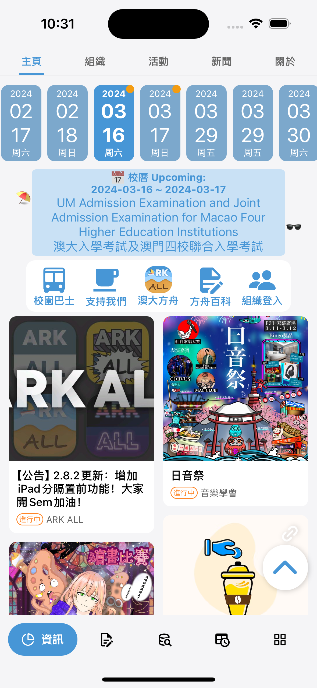
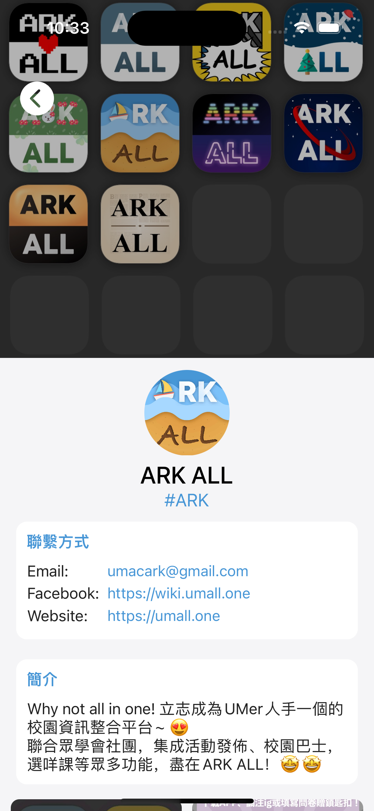
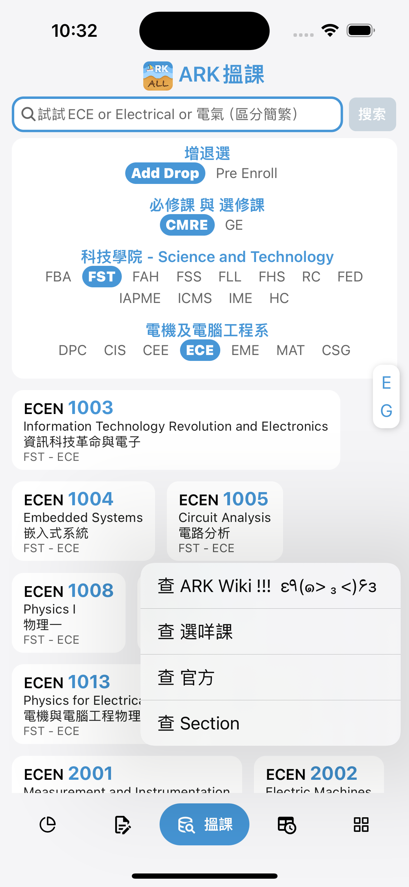
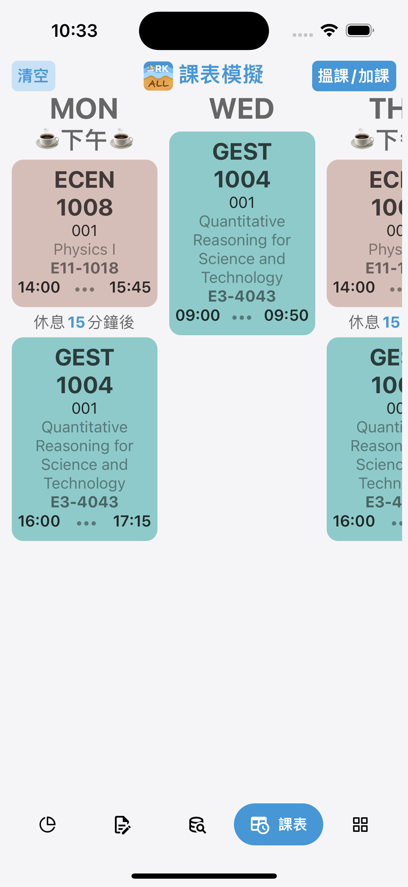
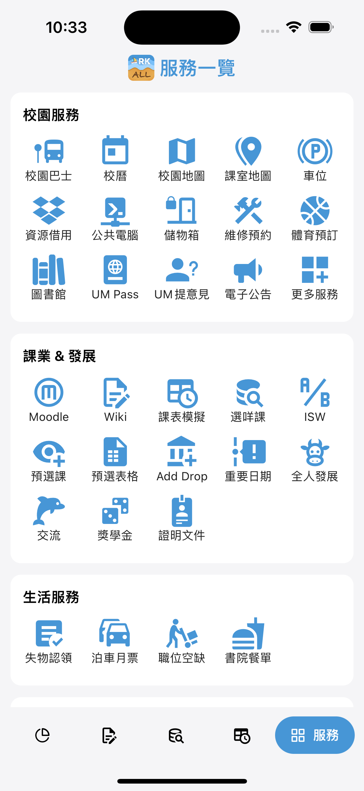
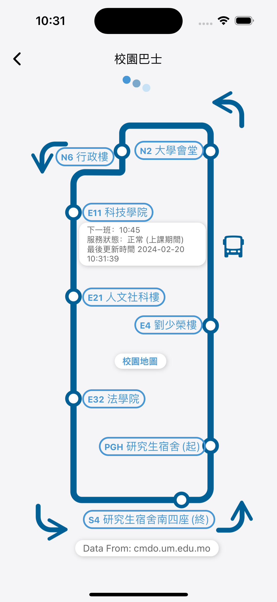
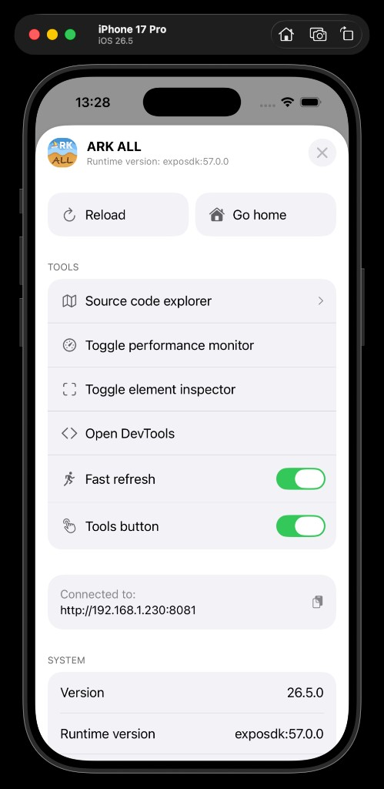

## **🎉 ARK ALL 是一個免費的開源 APP 🎉**

[](https://github.com/UM-ARK/UM-All-Frontend/releases/latest)

<div align="center">
<a href="https://apps.apple.com/app/id1636670554" style="display:inline-block;">
  
</a>
<a href="https://play.google.com/store/apps/details?id=one.umall" style="display:inline-block;">
  
</a>
</div>

- 感興趣的話可以來 Wiki 看看更多[關於 ARK 的故事](https://wiki.umall.one/wiki/ARK_ALL) ~
- 如果 ARK ALL 有幫助到您，可以請我們[喝杯咖啡](https://github.com/UM-ARK/Donate)！
- 如果您也想參與到 ARK ALL 的開發中，立即聯繫我們 `umacark@gmail.com`！

<div align="center">

**APP 熒幕截圖**

| | | |
| :---: | :---: | :---: |
|  |  |  |
|  |  |  |

</div>

---

## 🧭 關於 ARK ALL

**ARK ALL** 是一個面向**澳門大學（University of Macau）**社群的免費開源一站式校園生活平台，主要服務澳大本科生、研究生，亦兼顧教職員與校友的日常需求，提供**繁體中文**與**英文**雙語介面。

### 核心功能

| 模組 | 涵蓋內容 |
| --- | --- |
| **資訊** | 校園活動、學生組織、澳大新聞與站內搜尋 |
| **論壇（ARK Harbor）** | 澳大校園討論區、發帖互動、站內聊天與通知 |
| **選課** | 搵課目錄查詢（支援本科／研究生與歷史學期）與課表模擬（寬屏支援左右分屏） |
| **服務** | 校巴實時動態、停車場空位、餐飲開放時間、組隊排班、澳大部門與 ARK Wiki |
| **我的** | 個人主頁、信箱、成就徽章與主題／語言／無障礙設定 |

### 支援平台與技術棧

- **平台**：iOS／iPadOS、Android、Web 輕量工具版（[umall.one/webAPP](https://umall.one/webAPP/)，提供選課、服務與設定）
- **技術棧**：Expo（CNG 連續原生生成）+ React Native + React Navigation V7 + `pnpm`（具體依賴與 Node 版本以 [`package.json`](./package.json) 及 [`app.json`](./app.json) 為準）

---

## 📑 目錄

- [**🎉 ARK ALL 是一個免費的開源 APP 🎉**](#-ark-all-是一個免費的開源-app-)
- [🧭 關於 ARK ALL](#-關於-ark-all)
  - [核心功能](#核心功能)
  - [支援平台與技術棧](#支援平台與技術棧)
- [📑 目錄](#-目錄)
- [🚀 快速開始與開發環境](#-快速開始與開發環境)
  - [前置環境](#前置環境)
  - [1. 克隆與安裝依賴](#1-克隆與安裝依賴)
  - [2. 配置環境變數與 Firebase](#2-配置環境變數與-firebase)
    - [🔑 UM Open Data API Token 配置](#-um-open-data-api-token-配置)
    - [📋 Firebase 配置文件說明](#-firebase-配置文件說明)
  - [3. 生成原生工程（Expo CNG）](#3-生成原生工程expo-cng)
  - [4. 啟動開發與常用指令](#4-啟動開發與常用指令)
- [🐛 除錯與開發工具](#-除錯與開發工具)
  - [Metro 與 Dev Menu / Tools button](#metro-與-dev-menu--tools-button)
  - [Google Firebase Analytics DebugView](#google-firebase-analytics-debugview)
  - [iOS 模擬器截圖（覆寫狀態列）](#ios-模擬器截圖覆寫狀態列)
- [📦 打包與部署](#-打包與部署)
  - [🍎 iOS 打包](#-ios-打包)
    - [方式一：EAS 雲端建置（推薦）](#方式一eas-雲端建置推薦)
    - [方式二：本地 Xcode Archive](#方式二本地-xcode-archive)
    - [本地 Release 真機除錯（不走 EAS）](#本地-release-真機除錯不走-eas)
  - [🤖 Android 打包](#-android-打包)
    - [方式一：EAS 雲端建置（推薦）](#方式一eas-雲端建置推薦-1)
    - [方式二：本地 Gradle 建置／真機 Release 測試](#方式二本地-gradle-建置真機-release-測試)
    - [本機 Release 簽名設定](#本機-release-簽名設定)
  - [🌐 Web 版部署](#-web-版部署)
    - [關鍵配置（三處須保持一致）](#關鍵配置三處須保持一致)
    - [匯出與同步到伺服器](#匯出與同步到伺服器)
    - [已知限制](#已知限制)
- [⛵ 維護與貢獻指南](#-維護與貢獻指南)

---

## 🚀 快速開始與開發環境

開發規範、架構說明與 AI 協作指引請參閱 [`AGENTS.md`](./AGENTS.md)；常見報錯與排雷請見 [除錯手冊](./README/debugging_doc.md)。

### 前置環境

- **Node.js**：依 [`package.json`](./package.json) 的 `engines.node` 安裝對應 LTS 版本
- **pnpm**：本專案使用 `pnpm`，請先執行 `corepack enable` 啟用
- **iOS（僅限 macOS）**：Xcode 15+、Watchman（`brew install watchman`）；Expo CNG 會自動處理 CocoaPods，無需手動跑 `pod install`
- **Android**：Android Studio、Android SDK 與模擬器、JDK 18+

### 1. 克隆與安裝依賴

```console
git clone https://github.com/UM-ARK/UM-All-Frontend.git
cd UM-All-Frontend
corepack enable
pnpm install
```

### 2. 配置環境變數與 Firebase

#### 🔑 UM Open Data API Token 配置

新聞、活動、停車場即時資料等 `api.data.um.edu.mo` 請求需要授權金鑰。程式透過 `src/utils/pathMap.js` 匯出的 `UM_API_TOKEN` 讀取 **`process.env.EXPO_PUBLIC_UM_API_TOKEN`**（Expo 僅內嵌 `EXPO_PUBLIC_*` 前綴變數）。

1. 在專案根目錄（與 `package.json` 同層）建立 `.env` 或 `.env.local`：

```bash
EXPO_PUBLIC_UM_API_TOKEN=你的_UM_Open_Data_Token
```

2. 修改環境變數後請**重啟 Metro**（如 `pnpm start` 清除快取）。
3. **版控與安全**：`.env`、`.env.local` 已列於 `.gitignore`，**切勿將真實 Token 提交到 Git**（舊版 `umAPIToken.json` 已不再讀取）。
4. **EAS 雲端建置**：雲端不會自動帶上本機 `.env`，請於 [Expo Environment variables](https://docs.expo.dev/eas/environment-variables/) 為對應 profile 設定同名變數 `EXPO_PUBLIC_UM_API_TOKEN`。
5. **取得方式**：依澳門大學 Open Data 官方流程申請；開源貢獻者若暫無金鑰，僅影響相關 Open Data 畫面，其餘功能仍可正常開發。

#### 📋 Firebase 配置文件說明

| 平台 | 文件路徑 | 用途 |
| --- | --- | --- |
| Android | `google-services.json`（專案根目錄） | Firebase Analytics |
| iOS | `GoogleService-Info.plist`（專案根目錄） | Firebase Analytics |

從 [Firebase Console](https://console.firebase.google.com/) 建立專案並註冊包名 `one.umall` 後下載至專案根目錄（已列於 `.gitignore`，請勿提交真實金鑰）。

若僅需本地啟動開發（不使用真實 Firebase 功能），可先放入下方模板結構（請勿填入真實私密金鑰）：

<details>
<summary>展開查看 <code>google-services.json</code> 與 <code>GoogleService-Info.plist</code> 模板結構</summary>

`google-services.json`：

```json
{
  "project_info": {
    "project_number": "000000000000",
    "project_id": "your-project-id",
    "storage_bucket": "your-project-id.appspot.com"
  },
  "client": [
    {
      "client_info": {
        "mobilesdk_app_id": "1:000000000000:android:0000000000000000000000",
        "android_client_info": {
          "package_name": "one.umall"
        }
      },
      "oauth_client": [],
      "api_key": [
        {
          "current_key": "YOUR_API_KEY"
        }
      ],
      "services": {
        "appinvite_service": {
          "other_platform_oauth_client": []
        }
      }
    }
  ],
  "configuration_version": "1"
}
```

`GoogleService-Info.plist`：

```xml
<?xml version="1.0" encoding="UTF-8"?>
<!DOCTYPE plist PUBLIC "-//Apple//DTD PLIST 1.0//EN" "http://www.apple.com/DTDs/PropertyList-1.0.dtd">
<plist version="1.0">
<dict>
    <key>CLIENT_ID</key>
    <string>000000000000-xxxxxxxxxxxxxxxxxxxxxxxxxxxxxxxx.apps.googleusercontent.com</string>
    <key>REVERSED_CLIENT_ID</key>
    <string>com.googleusercontent.apps.000000000000-xxxxxxxxxxxxxxxxxxxxxxxxxxxxxxxx</string>
    <key>API_KEY</key>
    <string>YOUR_API_KEY</string>
    <key>GCM_SENDER_ID</key>
    <string>000000000000</string>
    <key>PLIST_VERSION</key>
    <string>1</string>
    <key>BUNDLE_ID</key>
    <string>one.umall</string>
    <key>PROJECT_ID</key>
    <string>your-project-id</string>
    <key>STORAGE_BUCKET</key>
    <string>your-project-id.appspot.com</string>
    <key>IS_ADS_ENABLED</key>
    <false/>
    <key>IS_ANALYTICS_ENABLED</key>
    <false/>
    <key>IS_APPINVITE_ENABLED</key>
    <true/>
    <key>IS_GCM_ENABLED</key>
    <true/>
    <key>IS_SIGNIN_ENABLED</key>
    <true/>
    <key>GOOGLE_APP_ID</key>
    <string>1:000000000000:ios:0000000000000000000000</string>
</dict>
</plist>
```

</details>

### 3. 生成原生工程（Expo CNG）

本專案採 **Expo CNG（Continuous Native Generation）**，`ios/` 與 `android/` 目錄由 `app.json` 及 `plugins/` 自動生成（已列於 `.gitignore`）：

- **何時需要執行 `prebuild`**：首次 clone 專案、增刪原生依賴、或修改 `app.json`／`plugins/` 時。
- **何時不需要執行**：日常修改 JS 程式碼直接靠 Metro 熱重載即可，亦**無需手動執行 `pod install`**。

```console
npx expo prebuild --clean                    # 同時生成 iOS 與 Android 原生工程
npx expo prebuild --clean --platform ios     # 僅生成 iOS
npx expo prebuild --clean --platform android # 僅生成 Android
```

> 若 iOS prebuild／編譯時因網路對 Maven Central 返回 HTTP 403 而找不到 `ReactNativeFeatureFlagsDefaults.h`、`folly/dynamic.h` 等 header，請見 [除錯手冊：iOS 預編譯依賴下載失敗](./README/debugging_doc.md#ios-預編譯依賴下載失敗http-403)。

### 4. 啟動開發與常用指令

| 操作 | 指令 | 說明 |
| --- | --- | --- |
| 啟動 Metro | `pnpm start` | 清快取啟動開發伺服器（`--reset-cache`） |
| 運行 iOS（選擇裝置） | `pnpm ios` / `pnpm iosTrue` | 互動選擇模擬器或已連線真機 |
| 運行指定 iOS 模擬器 | `pnpm iosNew` / `pnpm iosBig` | iPhone 17 Pro / iPad Pro 13-inch (M5) |
| 運行 Android | `pnpm android` | 先於 Android Studio 啟動模擬器或連接真機 |
| 運行 Web | `npx expo start --web` | 啟動 Web 版，Metro 自動代理 `/api/*` |
| 程式碼檢查 | `pnpm lint` | 執行 ESLint |
| 單元測試 | `pnpm test` | 若遇 Watchman 權限錯誤請加 `-- --watchman=false` |

---

## 🐛 除錯與開發工具

### Metro 與 Dev Menu / Tools button

- **React DevTools**：在運行中的 Metro 終端機按下 `j` 即可開啟。
- **重新開啟 Dev Menu / Tools button**：若畫面上看不到浮動 **Tools** 按鈕，可透過以下方式開啟 Dev Menu 並開啟 `Tools button`：
  - **Metro 終端機**：按 `m` 開啟開發選單（或按 `i` 啟動 iOS）。
  - **iOS 模擬器**：按 `⌘ + D`，或選單 `Device → Shake`。
  - **真機**：搖晃裝置。

<div align="center">
  
</div>

### Google Firebase Analytics DebugView

依官方 [偵錯事件](https://firebase.google.com/docs/analytics/debugview) 啟用偵錯模式後，可在 Firebase Console 的 `DebugView` 查看近乎即時的 `logToFirebase` 事件上報。

### iOS 模擬器截圖（覆寫狀態列）

製作 App Store 截圖或更新展示圖時，可覆寫模擬器狀態列以保持乾淨畫面：

```console
xcrun simctl status_bar booted override \
  --time "9:41" \
  --cellularMode active \
  --cellularBars 4 \
  --wifiMode active \
  --wifiBars 3 \
  --batteryState charged \
  --batteryLevel 100
```

截圖完成後復原：

```console
xcrun simctl status_bar booted clear
```

更多建置與執行期排錯請見 [除錯手冊](./README/debugging_doc.md)。

---

## 📦 打包與部署

版本號統一於 [`app.json`](./app.json) 中管理，建置時會自動同步至原生工程。

### 🍎 iOS 打包

#### 方式一：EAS 雲端建置（推薦）

```console
pnpm add -g eas-cli
eas login
eas build --platform ios
```

#### 方式二：本地 Xcode Archive

1. 確認已執行 `npx expo prebuild --clean --platform ios`。
2. 開啟 `./ios/ARKALL.xcworkspace`（以實際生成的 `.xcworkspace` 為準）。
3. 確認 **Signing & Capabilities** 後使用 `Product → Archive` 歸檔與發佈。

#### 本地 Release 真機除錯（不走 EAS）

需要在本機快速驗證 Release 組態且具備有效 Apple 開發者簽名環境時，連接真機後執行：

```console
pnpm iosRelease
```

---

### 🤖 Android 打包

#### 方式一：EAS 雲端建置（推薦）

```console
eas build --platform android
```

- **APK**：內部分發測試
- **AAB（Android App Bundle）**：Google Play Store 正式上架

#### 方式二：本地 Gradle 建置／真機 Release 測試

1. 確認已執行 `npx expo prebuild --clean --platform android` 並完成下方簽名設定。
2. 執行建置（需 JDK 18+）：

```console
pnpm androidRelease            # 直接安裝 Release 到已連接真機

# 或手動產出安裝包
cd android
./gradlew assembleRelease      # 產出 APK
./gradlew bundleRelease        # 產出 AAB (Google Play)
```

#### 本機 Release 簽名設定

`app.json` 已掛載 `./plugins/withAndroidSigning`，`expo prebuild` 會自動將 Release `signingConfigs` 注入 `android/app/build.gradle`，**無需手動改寫 `build.gradle`**。只有當 Gradle 讀到 `MYAPP_RELEASE_*` 屬性時才會套用正式 keystore；**切勿將密碼寫入倉庫內的檔案**。

1. **放置 Keystore**：`MYAPP_RELEASE_STORE_FILE` 會解析為**相對於專案根目錄**的路徑（例如放於根目錄的 `keystore.keystore`，已列於 `.gitignore`）。
2. **設定本機 `~/.gradle/gradle.properties`**（全機共用、不進專案版控）：

```properties
# Android Release 簽名（僅本機，勿提交）
# MYAPP_RELEASE_STORE_FILE：相對「專案根目錄」的 keystore 路徑
MYAPP_RELEASE_STORE_FILE=keystore.keystore
MYAPP_RELEASE_STORE_PASSWORD=你的_store_密碼
MYAPP_RELEASE_KEY_ALIAS=你的_key_alias
MYAPP_RELEASE_KEY_PASSWORD=你的_key_密碼
```

3. **CI / EAS**：請改用 EAS 的 [Android 憑證管理](https://docs.expo.dev/app-signing/app-credentials/) 或 Secrets，不依賴本機 `~/.gradle/gradle.properties`。

---

### 🌐 Web 版部署

Web 版是 `react-native-web` 匯出的純靜態單頁應用（入口 `App.web.js`、路由 `src/Nav.web.js`），部署於 **https://umall.one/webAPP/**，與 `/api/` 同源因此不觸發 CORS。

#### 關鍵配置（三處須保持一致）

| 位置 | 內容 | 作用 |
| --- | --- | --- |
| `app.json` → `experiments.baseUrl` | `"/webAPP"` | 讓 `index.html` 與 bundle 資源路徑帶上子路徑前綴 |
| `src/Nav.web.js` → `WEB_BASE_PATH` | `'webAPP'` | 讓 React Navigation 路由維持於 `/webAPP/` 下，刷新不落入官網 |
| 伺服器 nginx `location /webAPP/` | `alias /data/umall/webAPP/` | 靜態文件目錄與 SPA fallback |

#### 匯出與同步到伺服器

```console
npx expo export --platform web
rsync -avz --delete dist/ ARK_ALL_Server_OVH:/data/umall/webAPP/
```

- 產物位於 `dist/`（已 gitignore），`--delete` 會清掉舊 hash 檔；nginx 無需重啟即生效。
- 本地檢查時**不要**用 Live Server 直接開 `dist/index.html`（資源為 `/webAPP/...` 絕對路徑會白屏），請用 `npx expo start --web` 調試，或同步後驗證。

<details>
<summary>展開查看伺服器 nginx 配置與上線驗證指令</summary>

在 `/etc/nginx/sites-available/umall.one.conf` 的 443 server 塊裡、`location /`（反代官網 Next.js）**之前**：

```nginx
location = /webAPP {
    return 301 /webAPP/;
}

location /webAPP/_expo/ {
    alias /data/umall/webAPP/_expo/;
    add_header Cache-Control "public, max-age=31536000, immutable";
}

location = /webAPP/index.html {
    alias /data/umall/webAPP/index.html;
    add_header Cache-Control "no-cache";
}

location /webAPP/ {
    alias /data/umall/webAPP/;
    try_files $uri $uri/ /webAPP/index.html;
}
```

重載並驗證：

```console
sudo nginx -t && sudo systemctl reload nginx
for u in /webAPP /webAPP/ /webAPP/course/CISC1001 /webAPP/favicon.ico; do curl -s -o /dev/null -w "$u %{http_code} cache=%header{cache-control}\n" "https://umall.one$u"; done
```

</details>

#### 已知限制

- Cloudflare 會於 `index.html` 注入 `/cdn-cgi/` 腳本並壓縮 bundle，屬正常現象。
- `umall.one/app/*` 為官網（Next.js）分享落地頁專用，Web 版不可佔用。
- 課程輔助資料來源 `umeh.top` 未回傳 CORS 標頭，Web 端請求會被瀏覽器攔截。
- `src/Nav.web.js` 的 linking 僅宣告頂層與特定深鏈接，未宣告的深層嵌套頁刷新會回到預設 Tab。

---

## ⛵ 維護與貢獻指南

- **開發與程式碼規範**：請先閱讀 [`AGENTS.md`](./AGENTS.md)，細節按領域分置於 [`.cursor/rules/`](./.cursor/rules/)：
  - 設計系統、主題配色、按壓與**觸覺回饋 11 種語意標準**：[`.cursor/rules/design-system.mdc`](./.cursor/rules/design-system.mdc)
  - 寬屏（iPad／Web）響應式佈局：[`.cursor/rules/responsive-layout.mdc`](./.cursor/rules/responsive-layout.mdc)
  - 架構與導覽：[`.cursor/rules/architecture-navigation.mdc`](./.cursor/rules/architecture-navigation.mdc)
  - 資料儲存與 API：[`.cursor/rules/data-storage-api.mdc`](./.cursor/rules/data-storage-api.mdc)
  - 多語言翻譯策略：[`.cursor/rules/i18n-patterns.mdc`](./.cursor/rules/i18n-patterns.mdc)
- **常規維護 SOP**（詳細步驟見 [`.agents/skills/`](./.agents/skills/)）：
  1. **澳大校曆更新**：從 `https://reg.um.edu.mo/university-almanac/?lang=zh-hant` 取得 `.ics` 並轉為 `src/static/UMCalendar/UMCalendar.js`（鍵名維持小寫駝峰並補齊 `summary_cn` 繁體翻譯），同時檢查 `CalendarConst.js`。
  2. **澳大課程目錄更新**：採用 v2 catalog 架構（`preenrollCatalog.json`、`adddropCatalog.json`、`adddropCatalogPG.json`），詳見 [`src/static/UMCourses/README.md`](./src/static/UMCourses/README.md)。
  3. **Harbor Emoji 映射更新**：執行 `node scripts/updateHarborEmojiShortcodes.js`。
  4. **App Icon 更新**：替換 `app.json` 指定的圖片資源（`src/static/img/logo.png`、`ic_launcher_foreground.png` 等）後重新執行 `npx expo prebuild --clean`。
  5. **提交訊息**：採用 Gitmoji + 繁體中文，詳見 [`.agents/skills/git-commit/SKILL.md`](./.agents/skills/git-commit/SKILL.md)。
